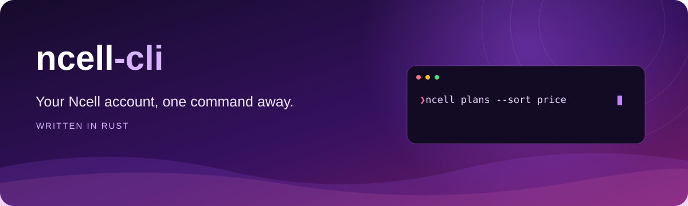

<div align="center">




**[Read the documentation →](https://rohityadav-sas.github.io/ncell-cli/)**

</div>

## Example

```sh
ncell plans search "SMS" --category 50 --sort price
```

### Output

```text
ID      Plan                             Price    Validity
--------------------------------------------------------------
984     1 Day: 100 All Net SMS          Rs. 15       1 DAY
985     7 Day: 300 All Net SMS          Rs. 45       7 DAY
986     28 Day: 300 All Net SMS         Rs. 98      28 DAY
987     28 Day : 850 All Net SMS       Rs. 125      28 DAY
```

## Interactive mode

```sh
ncell
```

Live dropdown completion, argument hints, script files and plan categories are available without shell setup. Commands execute against your saved account. See the [interactive guide](https://rohityadav-sas.github.io/ncell-cli/#interactive).

## Installation

**Quick install (Linux / macOS)**

```sh
curl -fsSL https://raw.githubusercontent.com/rohityadav-sas/ncell-cli/main/install.sh | sh
```

**Quick install (Windows PowerShell)**

```powershell
irm https://raw.githubusercontent.com/rohityadav-sas/ncell-cli/main/install.ps1 | iex
```

| OS  | Installs to |
| --- | --- |
| Linux / macOS | `~/.local/bin/ncell` | 
| Windows | `%LOCALAPPDATA%\Programs\ncell-cli\ncell.exe` |

Install a specific version or in a specific folder:

**Linux / macOS**
```sh
curl -fsSL https://raw.githubusercontent.com/rohityadav-sas/ncell-cli/main/install.sh | NCELL_VERSION=v0.5.6 sh
```
**Windows**
```powershell
$env:NCELL_VERSION = 'v0.5.6'; irm https://raw.githubusercontent.com/rohityadav-sas/ncell-cli/main/install.ps1 | iex
```

`NCELL_INSTALL_DIR` changes the install folder in both scripts. On Linux and macOS it must be an absolute path; on Windows, relative paths are converted to full paths before installation.

### Updating

Run `ncell -U` (or `ncell update`) at any time to check for and install the latest release:

```sh
ncell -U
```

You can also re-run the quick install command above to update.

To uninstall, simply delete the `ncell` binary from the install folder.
