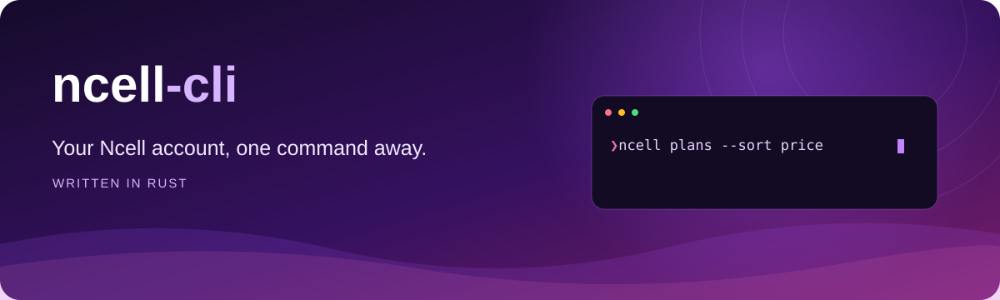

<div align="center">




**[Read the documentation →](https://rohityadav-sas.github.io/ncell-cli/)**

</div>

## Commands

```sh
ncell login 98XXXXXXXX
ncell balance
ncell plans categories
ncell plans --category 50
ncell plans subscribe 984 --category 50
ncell game status
ncell game ranks
ncell game spin --count 3 --delay 1.5s
ncell game scratch --count 3 --delay 1.5s
ncell game math --count 3 --delay 1.5s
ncell game check-in
ncell game claim-task 1,2,3
ncell --help
```

Actions and required inputs are plain words; options use `--long-name` (no short flags). Add `--json` for JSON output.

## Example

```sh
ncell plans search "SMS" --category 50 --sort price
```

### Output
```text
ID      Plan                             Price    Validity
--------------------------------------------------------------
984     1 Day: 100 All Net SMS          Rs. 15       1 DAY
985     7 Day: 300 All Net SMS          Rs. 45       7 DAY
986     28 Day: 300 All Net SMS         Rs. 98      28 DAY
987     28 Day : 850 All Net SMS       Rs. 125      28 DAY
```

## Installation

**WinGet (Windows)**

```powershell
winget install --id RohitYadav.NcellCLI
```

**Scoop (Windows)**

```powershell
scoop bucket add ncell-cli https://github.com/rohityadav-sas/ncell-cli
scoop install ncell-cli
```

**Homebrew (macOS / Linux)**

```sh
brew tap rohityadav-sas/ncell-cli https://github.com/rohityadav-sas/ncell-cli
brew install ncell-cli
```

**From source**

Install [rustup](https://rustup.rs/) and Git, then clone the repository and install the executable on your `PATH`:

```sh
git clone https://github.com/rohityadav-sas/ncell-cli.git
cd ncell-cli
cargo install --path . --locked
ncell --help
```

**Prebuilt binaries**

Download a ZIP from [Releases](https://github.com/rohityadav-sas/ncell-cli/releases/latest) for your platform:

| Platform | Architecture | Archive suffix |
| --- | --- | --- |
| Windows | x64 | `windows-x86_64.zip` |
| Windows | ARM64 | `windows-arm64.zip` |
| Linux | x64 | `linux-x86_64.zip` |
| Linux | ARM64 | `linux-arm64.zip` |
| macOS | Intel | `macos-x86_64.zip` |
| macOS | Apple Silicon | `macos-arm64.zip` |

Extract the ZIP and run `ncell --help` (`.\ncell.exe --help` on Windows). On Linux and macOS, run `chmod +x ncell` first, then `./ncell --help`. Add the executable's directory to your `PATH` to run it anywhere.

Linux credential storage requires an unlocked Secret Service provider, such as GNOME Keyring or KWallet with Secret Service enabled.
